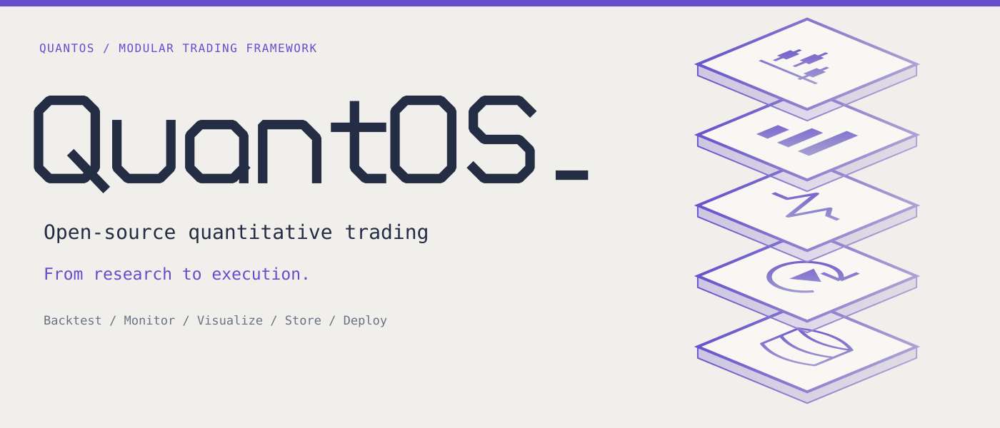

<p align="center">
  <a href="https://pypi.org/project/investing-algorithm-framework/"></a>
  <a href="https://github.com/coding-kitties/investing-algorithm-framework/actions/workflows/test.yml?query=branch%3Amain"></a>
  <a href="https://pypi.org/project/investing-algorithm-framework/"></a>
  <a href="https://opensource.org/licenses/Apache-2.0"></a>
  <a href="https://coding-kitties.github.io/investing-algorithm-framework/"></a>
  <a href="https://github.com/coding-kitties/investing-algorithm-framework/stargazers"></a>
  <a href="https://finterion.com"></a>
  <a href="https://finterion.com/community/forum"></a>
</p>

# QuantOS

> **Note:** QuantOS is the new name for the Investing Algorithm Framework and introduces several improvements and changes to the framework. Old references to the framework, such as package names and documentation URLs, still use the previous name but will be updated over time. You can install all the new versions of QuantOS using the existing package name:
>
> ```bash
> pip install quantos
> ```

**From research to execution.**

QuantOS (formerly Investing Algorithm Framework) is a Python framework for the complete quantitative
trading workflow. Define a strategy once, explore it with vector backtests,
validate it in an event-driven simulation, inspect the results in an interactive
dashboard, and run the same strategy in paper or live trading.


>**Note:** The current documentation website is not fully up-to-date with v9 of QuantOS. If you need guidance or have any questions please reach out on the [forum](https://finterion.com/community/forum).

[Get started](#getting-started) · [Features](#feature-highlights) · [Integrations](#integrations--ecosystem) · [Guides & examples](#guides--examples) · [Dashboard](#dashboard) · [Deployment](#deployment) · [Forum](#join-the-quantos-forum-hosted-on-finterioncom)

## Join the QuantOS forum hosted on Finterion.com

Building a strategy, exploring backtest results, or getting started with QuantOS?
Connect with the community on the Finterion forum to ask questions, share what
you're building, discuss trading research, and help shape the framework.

[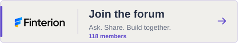](https://finterion.com/community/forum)

**[Join the forum](https://finterion.com/community/forum)** — bring a question,
share a strategy, or start a discussion.

## QuantOS Sponsors and Infrastructure Partners

[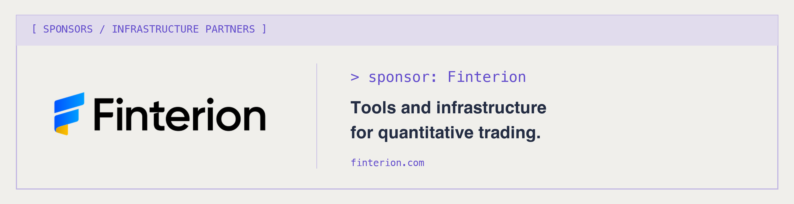](https://finterion.com)

## Getting started

> **v9 is now available.**
>
> ```bash
> pip install investing-algorithm-framework==9.0.0
> ```
>
> See the [v9.0 release notes](docusaurus/blog/2026-08-02-v9.0-release.md)
> and [changelog](CHANGELOG.md). This README targets **v9 and later**;
> its APIs and examples may not work with earlier versions.

> **Documentation update in progress.** Our current documentation is out of date,
> and we're working hard to bring it up to date with **v9.0**. If you have
> questions or need help, please [start a question on the QuantOS forum hosted on Finterion.com](https://finterion.com/community/forum).

[Installation guide](https://coding-kitties.github.io/investing-algorithm-framework/Getting%20Started/installation) · [Tutorial notebooks](examples/tutorial/README.md) · [Strategy showcase](examples/algorithm_examples/strategies_showcase/README.md)

## Feature highlights

### Define strategies

- 🧠 **[Advanced strategy definitions](#3-confluence-scoring-declare-indicators-and-decisions):** Combine declarative indicators and data streams, confluence-scored entry and exit decisions, and position sizing and risk rules.
- 🧮 **[Cross-sectional pipelines](https://coding-kitties.github.io/investing-algorithm-framework/Advanced%20Concepts/pipelines):** Rank, filter, and score entire universes of symbols during each strategy iteration.
- 🧠 **[Confluence scoring cards](https://coding-kitties.github.io/investing-algorithm-framework/Advanced%20Concepts/confluence-cards):** Build explainable decisions from requirements, weighted evidence, vetoes, and score thresholds.

### Backtest and validate

- ⚡ **[Vector backtesting](https://coding-kitties.github.io/investing-algorithm-framework/Getting%20Started/vector-backtesting):** Evaluate signals and sweep thousands of strategy variants quickly with Polars-powered execution.
- 🏃 **[Event-driven backtesting](https://coding-kitties.github.io/investing-algorithm-framework/Getting%20Started/event-backtesting):** Validate candidates bar by bar with realistic orders, fills, costs, and portfolio management.
- 🪟 **[Studies, universes, and backtest windows](https://coding-kitties.github.io/investing-algorithm-framework/Getting%20Started/studies):** Define the assets, assumptions, and rolling, anchored, holdout, walk-forward, time-OOS, or universe-OOS periods for each experiment.
- 🔀 **[Monte Carlo testing](https://coding-kitties.github.io/investing-algorithm-framework/Advanced%20Concepts/permutation-testing):** Measure how often randomized market paths match or outperform a strategy's observed results.

### Inspect, compare, and store

- 🗂️ **[Open Backtest Format](https://coding-kitties.github.io/investing-algorithm-framework/Getting%20Started/open-backtest-format):** Keep complete vector and event results in portable, versioned `.obtf` bundles.
- 🗄️ **[Tiered storage and indexing](https://coding-kitties.github.io/investing-algorithm-framework/Getting%20Started/backtest-storage):** Rank and filter 10,000+ backtests through SQLite without decoding full result bundles.
- 📊 **[80+ performance metrics](https://coding-kitties.github.io/investing-algorithm-framework/Getting%20Started/metrics):** Analyze CAGR, Sharpe, Sortino, Calmar, VaR/CVaR, drawdown, recovery, and benchmark-relative returns.
- 📈 **[Interactive dashboard](https://coding-kitties.github.io/investing-algorithm-framework/Getting%20Started/backtest-reports):** Compare strategies, inspect trades and charts, review window coverage, and save a self-contained HTML report.

### Trade and manage risk

- 🔁 **[Long and short trading](https://coding-kitties.github.io/investing-algorithm-framework/Getting%20Started/orders):** Define entry and exit signals once and run the same strategy in vector backtests, event-driven backtests, paper trading, and live trading.
- 🛡️ **[Declarative risk rules](https://coding-kitties.github.io/investing-algorithm-framework/Risk%20Rules/overview):** Configure sizing, exposure limits, scaling, stop losses, take profits, and signal cooldowns.
- 💸 **[Execution cost models](https://coding-kitties.github.io/investing-algorithm-framework/Risk%20Rules/trading-cost):** Apply percentage, fixed, basis-point, or volume-aware commission and slippage assumptions.
- 🔐 **[Portfolio and credentials management](https://coding-kitties.github.io/investing-algorithm-framework/Getting%20Started/portfolio-configuration):** Configure markets, balances, fees, paper trading, and environment-based credentials without hardcoding secrets.
- ↔️ **[Position modes: NETTING vs. HEDGE](https://coding-kitties.github.io/investing-algorithm-framework/Advanced%20Concepts/position-modes):** Choose one net direction per symbol or maintain independent long and short legs with separate risk controls and P&L.

### Deploy and extend

- 🚀 **[Flexible deployment](https://coding-kitties.github.io/investing-algorithm-framework/Getting%20Started/deployment):** Run locally, self-host, deploy to AWS Lambda or Azure Functions, or publish through Finterion.
- 🌐 **[Extensible integrations](https://coding-kitties.github.io/investing-algorithm-framework/Advanced%20Concepts/custom-data-providers):** Add custom data providers, order executors, storage adapters, metrics, strategies, and optimizers.
- 🤖 **[Built-in MCP server](https://coding-kitties.github.io/investing-algorithm-framework/Advanced%20Concepts/mcp-server):** Let compatible AI tools query backtests, compare strategies, inspect trades, and manage research notes.

## Integrations & ecosystem

Build with QuantOS. Extend your workflow with optional integrations for
research, deployment, monitoring, and distribution.

### Finterion — quantitative trading infrastructure

[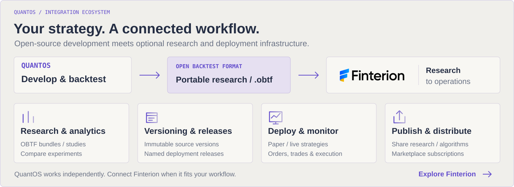](https://finterion.com)

[Finterion](https://finterion.com) connects your QuantOS strategies to hosted
research and trading infrastructure. Organize backtest experiments, manage
versioned releases, and deploy and monitor paper or live strategies.

| Your workflow | What Finterion adds |
| --- | --- |
| Research & evaluation | Upload portable `.obtf` results, organize studies and research bundles, and compare experiments. |
| Versioning & releases | Manage immutable source versions and named releases tied to deployments. |
| Deployment & monitoring | Deploy paper or live strategies and monitor orders, trades, and execution activity. |
| Publishing & distribution | Share research, publish algorithms, and distribute strategies through the marketplace. |

[](https://finterion.com)
[](https://github.com/Finterion/finterion-investing-algorithm-framework-plugin)

**Optional by design.** QuantOS remains usable independently. Finterion extends
your workflow; it is not required to develop, backtest, or run strategies.

## Guides & examples

Expand a guide for implementation details, code examples, and execution-mode
limitations. Start with **Strategy Definition** for the recommended confluence
scoring approach.

[Strategy definition](#strategy-definition) · [Backtesting](#backtesting) · [Storage](#backtest-storage) · [Portfolio & credentials](#portfolio-and-credentials-management) · [Position modes](#position-modes) · [Pipelines](#pipelines) · [Monte Carlo](#monte-carlo-testing)

<a id="strategy-definition"></a>
<details>
<summary><strong>Strategy Definition</strong></summary>
<br>

There are three ways to define a strategy: use `TradingStrategy` for direct
orders or custom signals, or its `ConfluenceScoringStrategy` subclass for
declarative indicator-driven decisions. All declare their data and schedule;
choose how much of the trading logic you want to manage yourself:

> **Recommended: start with `ConfluenceScoringStrategy`.** We recommend it over
> the other two approaches because it:
> - Provides both event and vector signal hooks, avoiding duplicated signal logic.
> - Keeps indicator calculations, scoring rules, and thresholds declarative.
> - Records explainable decision traces in event mode.
> - Uses the shared sizing, risk, execution, and cooldown pipeline.
>
> Use custom signals or direct orders as escape hatches when your strategy needs
> behavior that the declarative API cannot express.

| Style | Define | Execution modes |
| --- | --- | --- |
| **Direct orders** | Override `run_strategy` and place orders through `Context`. | Event backtests, paper, and live trading |
| **Custom signals** | Implement `generate_signals` and `generate_signal_series`; let the framework size and execute orders. | Both backtest engines, paper, and live trading |
| **Confluence scoring (recommended)** | Subclass `ConfluenceScoringStrategy` and declare indicators and scored entry/exit cards. | Both backtest engines, paper, and live trading |

### 1. Direct orders: control the event loop

> **No vector backtesting:** this approach supports event-driven backtests,
> paper trading, and live trading only. Use custom signals or confluence cards
> below if you need vector backtesting.

Use `run_strategy` when you need direct control over order conditions, sizing,
and routing. This replaces the default signal-processing pipeline: declaring
strategy risk rules alone does not apply that pipeline to your custom orders.

```python
from quantos import DataSource, OrderSide, Schedule, TimeUnit, TradingStrategy


class DirectOrderStrategy(TradingStrategy):
  schedule = Schedule.every(2, TimeUnit.HOUR)
  symbols = ["BTC"]
  data_sources = [DataSource(
    identifier="BTC_ohlcv", symbol="BTC/EUR", data_type="OHLCV", time_frame="2h",
    market="BITVAVO", pandas=True, warmup_window=30,
  )]

  def run_strategy(self, context, data):
    frame = data["BTC_ohlcv"]
    price = float(frame["Close"].iloc[-1])
    average = float(frame["Close"].rolling(20).mean().iloc[-1])

    if price > average and not context.has_position("BTC"):
      context.create_limit_order(
        target_symbol="BTC", price=price, order_side=OrderSide.BUY,
        percentage_of_portfolio=20,
      )
    elif price < average and context.has_position("BTC"):
      context.create_limit_order(
        target_symbol="BTC", price=price, order_side=OrderSide.SELL,
        percentage_of_position=100,
      )
```

The vector engine does not call `run_strategy`. For vector backtesting, express
the strategy as signal series instead.

### 2. Custom signals: share logic across both engines

Emit trading intent rather than orders. The framework applies its normal
conflict resolution, sizing, risk, execution, and cooldown phases.

```python
from quantos import DataSource, PositionSize, Schedule, \
    SignalSide, TimeUnit, TradingStrategy, \
    signal_series_from_column, signals_from_column


class MovingAverageSignalStrategy(TradingStrategy):
  schedule = Schedule.every(2, TimeUnit.HOUR)
  symbols = ["BTC"]
  data_sources = [DataSource(
    identifier="BTC_ohlcv", symbol="BTC/EUR", data_type="OHLCV", time_frame="2h",
    market="BITVAVO", pandas=True, warmup_window=30,
  )]
  position_sizes = [PositionSize(symbol="BTC", percentage_of_portfolio=20)]

  def _with_signals(self, data):
    frame = data["BTC_ohlcv"].copy()
    average = frame["Close"].rolling(20).mean()
    frame["open_long"] = frame["Close"] > average
    frame["close_long"] = frame["Close"] < average
    return frame

  def generate_signals(self, context, data):
    frame = self._with_signals(data)
    yield from signals_from_column(
      frame, "open_long", side=SignalSide.OPEN_LONG, symbol="BTC",
    )
    yield from signals_from_column(
      frame, "close_long", side=SignalSide.CLOSE_LONG, symbol="BTC",
    )

  def generate_signal_series(self, data):
    frame = self._with_signals(data)
    yield signal_series_from_column(
      frame, "open_long", side=SignalSide.OPEN_LONG, symbol="BTC",
    )
    yield signal_series_from_column(
      frame, "close_long", side=SignalSide.CLOSE_LONG, symbol="BTC",
    )
```

`generate_signals` evaluates the latest bar for event backtests, paper trading,
and live trading. `generate_signal_series` evaluates the full window for vector
backtests. Implement both to support both engines, sharing indicator logic to
keep their decisions consistent.

### 3. Confluence scoring: declare indicators and decisions

Inherit from `ConfluenceScoringStrategy` and declare `indicator_configs` plus
`confluence_cards`. The base class calculates the indicators and supplies both
signal hooks: no custom `prepare_signal_data`, `generate_signals`, or
`generate_signal_series` is needed.

This example uses `pyindicators` (`pip install pyindicators`). Pass its indicator
function as `calculate`, and declare the parameters and output columns explicitly.
Precomputation is appropriate here because RSI uses only present and past data.

```python
from pyindicators import rsi

from quantos import (
    ConfluenceScoringStrategy, ConfluenceScoreConfig, CooldownRule,
    DataSource, IndicatorConfig, IndicatorRule, PositionSize, Schedule,
    SignalSide, StopLossRule, TakeProfitRule, TimeUnit,
)


class RSIConfluenceStrategy(ConfluenceScoringStrategy):
  schedule = Schedule.every(2, TimeUnit.HOUR)
  symbols = ["BTC"]
  data_sources = [
    DataSource(
      identifier="BTC_ohlcv",
      symbol="BTC/EUR",
      data_type="OHLCV",
      time_frame="2h",
      market="BITVAVO",
      pandas=True,
      warmup_window=100,
    )
  ]

  indicator_configs = [
    IndicatorConfig(
      id="rsi",
      calculate=rsi,
      timeframe="2h",
      data_source="BTC_ohlcv",
      parameters={
        "source_column": "Close", "period": 14, "result_column": "rsi",
      },
      output_columns=["rsi"],
      minimum_history=15,
      history="continuous",
      execution="precompute",
    ),
  ]
  confluence_cards = [
    ConfluenceScoreConfig(
      id=name,
      side=side,
      symbols=["BTC"],
      rules={"rsi_threshold": IndicatorRule(
        indicator_id="rsi",
        output_column="rsi",
        threshold=threshold,
        comparison=comparison,
        group_weights={"primary": 1},
        lookback_period=1,
      )},
      group_aggregation={"primary": "sum"},
      group_thresholds={"primary": 1},
    )
    for name, side, threshold, comparison in (
      ("long_entry", SignalSide.OPEN_LONG, 30, "le"),
      ("long_exit", SignalSide.CLOSE_LONG, 70, "ge"),
      ("short_entry", SignalSide.OPEN_SHORT, 70, "ge"),
      ("short_exit", SignalSide.CLOSE_SHORT, 30, "le"),
    )
  ]

  position_sizes = [PositionSize(symbol="BTC", percentage_of_portfolio=20)]
  stop_losses = [
    StopLossRule(
      symbol="BTC",
      percentage_threshold=5,
      sell_percentage=100,
    )
  ]
  take_profits = [
    TakeProfitRule(
      symbol="BTC",
      percentage_threshold=10,
      sell_percentage=100,
    )
  ]
  cooldowns = [CooldownRule(trigger="any", blocks="any", bars=2)]
```

The framework evaluates each card's explicit `side` and score threshold, then
routes qualifying signals through the same sizing, risk, execution, and cooldown
pipeline as custom signals. Event mode also records decision traces. The four
cards above cover long entry and exit plus short entry and cover.

See the [declarative confluence strategy example](examples/framework_features/two_hour_confluence_strategy.py)
for callable indicators, staged scale-ins, and execution-engine limitations.

Fees and slippage belong to the portfolio or backtest study because they describe
a venue or scenario rather than signal logic.

See the [strategy guide](https://coding-kitties.github.io/investing-algorithm-framework/Getting%20Started/strategies),
the [basic example](docusaurus/docs/Getting%20Started/strategies.md#basic-strategy-structure),
and the [strategy showcase](examples/algorithm_examples/strategies_showcase/README.md).

</details>

[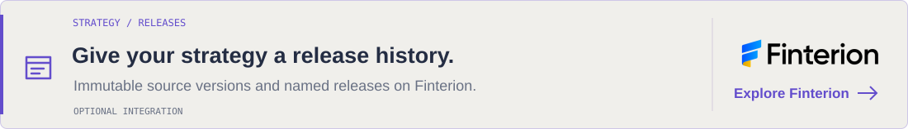](https://finterion.com)

[](https://github.com/Finterion/finterion-investing-algorithm-framework-plugin)


<a id="backtesting"></a>
<details>
<summary><strong>Backtesting</strong></summary>
<br>

Backtests use a `Study` to describe the experiment and a
`BacktestRunConfiguration` to control execution and persistence.

```python
from quantos import BacktestRunConfiguration

results = app.run_backtests(
    strategies=strategies,
    study=training_study,
    run_configuration=BacktestRunConfiguration(
        backtest_storage_directory="./my-backtests",
        n_workers=8,
        memory_budget_mb=16_384,
        min_available_memory_mb=4_096,
    ),
)

print(results.df)
```

Both engines return a disk-backed `BacktestIndex`. Use the index for scalar
filtering and ranking, then load selected full results with
`results.iter_backtests()` or `results.load_backtests()`.

### Vector Backtesting

The Polars-powered vector engine evaluates signal series in bulk. Use it for
rapid signal research, parameter sweeps, large candidate sets, and early-stage
filtering before running more expensive simulations.

<p align="center">
  <picture>
    <source media="(prefers-color-scheme: dark)" srcset="static/features/vector-backtest-dark.svg">
    <source media="(prefers-color-scheme: light)" srcset="static/features/vector-backtest-light.svg">
    
  </picture>
</p>

### Event-Driven Backtesting

The event engine processes market data bar by bar through the same strategy and
order path used in live trading. Use it to validate execution behavior, fills,
costs, portfolio changes, and interactions between strategies.

<p align="center">
  <picture>
    <source media="(prefers-color-scheme: dark)" srcset="static/features/event-backtest-dark.svg">
    <source media="(prefers-color-scheme: light)" srcset="static/features/event-backtest-light.svg">
    
  </picture>
</p>

### Robustness Studies

`Study`, `Universe`, and `BacktestWindow` support single-window tests, rolling
windows, anchored windows, holdouts, walk-forward k-fold validation, and
out-of-sample testing across time periods or universes. Execution assumptions
are captured with each study so results remain reproducible.

See the [vector backtesting guide](https://coding-kitties.github.io/investing-algorithm-framework/Getting%20Started/vector-backtesting),
the [event backtesting guide](https://coding-kitties.github.io/investing-algorithm-framework/Getting%20Started/event-backtesting),
and the [tutorial notebooks](examples/tutorial/README.md).

</details>

[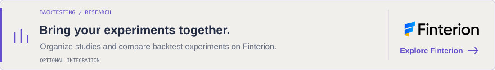](https://finterion.com)

[](https://github.com/Finterion/finterion-investing-algorithm-framework-plugin)


<a id="backtest-storage"></a>
<details>
<summary><strong>Backtest Storage</strong></summary>
<br>

Each algorithm is stored as a versioned `.obtf` bundle using the
[Open Backtest Format](https://github.com/Quant-Commons/Open-Backtest-Format).
A bundle can contain studies, universes, windows, vector and event runs,
summaries, metrics, trades, orders, positions, snapshots, execution assumptions,
and Monte Carlo results.

The storage layer scales from local research to large result collections:

| Tier | Purpose |
| --- | --- |
| SQLite index | Rank and filter scalar metrics across 10,000+ results without decoding bundles |
| `BacktestStore` | Swap flat `LocalDirStore` and partitioned `LocalTieredStore` layouts |
| OHLCV chunks | Deduplicate content-addressed market data shared by multiple bundles |

```bash
iaf index ./my-backtests/
iaf rank ./my-backtests/ --by sharpe_ratio \
  --where "summary_number_of_trades > 50" -n 20
iaf list ./my-backtests/ --sort calmar_ratio --json
iaf migrate-store --from local-dir --src ./my-backtests/ \
  --to local-tiered --dst ./tiered/
```

See the [storage layer example](examples/storage_layer_demo/README.md).

</details>

[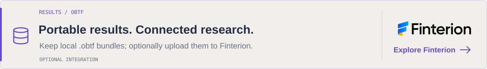](https://finterion.com)

[](https://github.com/Finterion/finterion-investing-algorithm-framework-plugin)


<a id="deployment"></a>
<details>
<summary><strong>Deployment</strong></summary>
<br>

The same strategy can run locally, in a container, as a web service, or in a
serverless function. Portfolio state, orders, trades, and positions can persist
across runs.

### Live Trading

Connect to supported exchanges through CCXT or implement an `OrderExecutor` for
a broker, FIX gateway, or custom venue. Live mode evaluates schedules, loads
market data, creates orders, and maintains portfolio state continuously.

### Paper Trading

Paper trading exercises the live strategy path without sending real orders.
Use it after event-driven validation to verify schedules, data feeds, credentials,
and operational behavior in current market conditions.

### Self-Hosted and Serverless

Run the application on your own machine or infrastructure, package it in Docker,
or scaffold AWS Lambda and Azure Functions projects from the CLI:

```bash
pip install investing-algorithm-framework
investing-algorithm-framework init
investing-algorithm-framework init --type aws_lambda
investing-algorithm-framework init --type azure_function
```

### Finterion

Publish validated strategies to the
[Finterion marketplace](https://www.finterion.com/) so investors can subscribe
to them. The Finterion plugin handles the framework integration.

<p align="center">
  <a href="https://www.finterion.com/" target="_blank">
    <picture>
      <source media="(prefers-color-scheme: dark)" srcset="static/features/marketplace-dark.svg">
      <source media="(prefers-color-scheme: light)" srcset="static/features/marketplace-light.svg">
      
    </picture>
  </a>
</p>

See the [deployment guide](https://coding-kitties.github.io/investing-algorithm-framework/Getting%20Started/deployment)
and [Finterion plugin](https://github.com/Finterion/finterion-investing-algorithm-framework-plugin).

</details>

[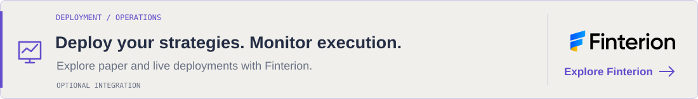](https://finterion.com)

[](https://github.com/Finterion/finterion-investing-algorithm-framework-plugin)


<a id="portfolio-and-credentials-management"></a>
<details>
<summary><strong>Portfolio and Credentials Management</strong></summary>
<br>

`app.add_market()` configures a portfolio and its market credentials together.
Set the trading currency, starting balance, fees, slippage, position mode, and
paper-trading behavior in one place:

```python
app.add_market(
  market="BITVAVO",
  trading_symbol="EUR",
  initial_balance=10_000,
  fee_percentage=0.1,
  paper_trading=True,
)
```

Keep secrets outside source code with market-scoped environment variables:

```bash
BITVAVO_API_KEY=<your-api-key>
BITVAVO_SECRET_KEY=<your-api-secret>
```

Explicit credentials from a secret manager can be registered with
`MarketCredential`. Deployment-level `BITVAVO_OVERRIDE_*` variables can enforce
credentials, paper mode, and managed balance regardless of values supplied by
the application.

Portfolio state, orders, positions, and trades persist across runs. Optional
portfolio synchronization reconciles broker balances and supports recurring or
one-off deposit schedules. Local paper trading requires no real credentials.

See [Portfolio Configuration](https://coding-kitties.github.io/investing-algorithm-framework/Getting%20Started/portfolio-configuration),
[Credential Management](https://coding-kitties.github.io/investing-algorithm-framework/Getting%20Started/credentials),
and [Portfolio Synchronization](https://coding-kitties.github.io/investing-algorithm-framework/Advanced%20Concepts/portfolio-sync).

</details>

<a id="dashboard"></a>
<details>
<summary><strong>Dashboard</strong></summary>
<br>

`BacktestReport` creates a self-contained interactive HTML dashboard. Compare
strategies, inspect equity and drawdown curves, review trades, analyze monthly
and yearly returns, check window coverage, and add research notes without
running a separate server.

<p align="center">
  <picture>
    <source media="(prefers-color-scheme: dark)" srcset="static/features/dashboard-dark.svg">
    <source media="(prefers-color-scheme: light)" srcset="static/features/dashboard-light.svg">
    
  </picture>
</p>

```python
from quantos import BacktestReport

# Materialize only the selected results when working with a large index.
BacktestReport(
    backtests=results.load_backtests(workers=1),
).save("backtest-report.html")

# Or reopen a directory of persisted bundles later.
BacktestReport.open(
    directory_path="./my-backtests/",
    workers=-1,
    show_progress=True,
).save("backtest-report.html")
```

The built-in MCP server lets compatible AI tools query stored backtests, compare
strategies, inspect trades, and work with report notes through
`investing-algorithm-framework mcp`.

See the [report guide](https://coding-kitties.github.io/investing-algorithm-framework/Getting%20Started/backtest-reports)
and [MCP server guide](https://coding-kitties.github.io/investing-algorithm-framework/Advanced%20Concepts/mcp-server).

</details>

[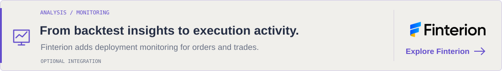](https://finterion.com)

[](https://github.com/Finterion/finterion-investing-algorithm-framework-plugin)

QuantOS's dashboard analyzes backtest results; Finterion's monitoring covers deployment execution activity.


<a id="advanced-features"></a>
<details>
<summary><strong>Advanced Features</strong></summary>
<br>

- **Backtest optimization:** plug in an ask/tell `StrategyOptimizer`, budget candidate evaluations, and resume saved search state.
- **Long and short trading:** use open/close signals for either side with fill-based P&L and collateral handling.
- **Cross-sectional pipelines:** rank, filter, and score a universe of symbols on each iteration.
- **Confluence cards:** combine primary conditions, weighted evidence, requirements, vetoes, and score thresholds.
- **Decision traces:** retain indicator values, rule outcomes, and scores for signals and no-op decisions.
- **Risk rules:** configure position sizing, exposure limits, scaling, stop losses, take profits, and signal cooldowns.
- **Execution models:** use percentage, fixed, basis-point, or volume-aware commission and slippage models.
- **Monte Carlo testing:** estimate whether performance could plausibly occur by chance.
- **Metrics and benchmarks:** analyze CAGR, Sharpe, Sortino, Calmar, VaR/CVaR, drawdown, recovery, and benchmark-relative performance.
- **External data and custom variables:** load cached CSV, JSON, or Parquet data and record strategy-specific values.
- **Portfolio synchronization:** model recurring or one-off deposits and reconcile live balances with a broker.
- **Bounded execution:** control workers, memory admission, checkpoints, progress, and failure handling for large sweeps.

See the [advanced concepts documentation](https://coding-kitties.github.io/investing-algorithm-framework/Advanced%20Concepts/)
and [backtest optimization guide](docusaurus/docs/Advanced%20Concepts/backtest-optimization.md).

</details>

<a id="position-modes"></a>
<details>
<summary><strong>Position Modes: NETTING vs. HEDGE</strong></summary>
<br>

Portfolios use `PositionMode.NETTING` by default: each symbol has one net
direction, so a long and short cannot coexist. Enable `PositionMode.HEDGE` to
maintain independent long and short legs for the same symbol, each with its own
entry, scaling, stop-loss, take-profit, cooldown, and P&L.

```python
from quantos import PositionMode

app.add_market(
  market="BITVAVO",
  trading_symbol="EUR",
  initial_balance=10_000,
  position_mode=PositionMode.HEDGE,
)
```

Both backtest engines support `OPEN_LONG`, `CLOSE_LONG`, `OPEN_SHORT`, and
`CLOSE_SHORT` independently in HEDGE mode. In NETTING mode,
`flip_on_opposite_signal=True` can close the current direction and open the
opposite direction on the same bar.

Live HEDGE trading requires an `OrderExecutor` and `PortfolioProvider` that
explicitly support it. The built-in CCXT adapters support NETTING only, so use
custom HEDGE-capable adapters for live execution.

See [Position Modes: NETTING vs. HEDGE](https://coding-kitties.github.io/investing-algorithm-framework/Advanced%20Concepts/position-modes).

</details>

<a id="pipelines"></a>
<details>
<summary><strong>Pipelines</strong></summary>
<br>

Pipelines compute factors across many symbols in one pass and return a tidy
cross-sectional table on each strategy iteration. Use them to define a tradeable
universe, rank candidates, normalize factors, and construct multi-factor or
risk-neutral signals without manually looping over symbols.

```python
from quantos import AverageDollarVolume, Pipeline, Returns


class MomentumScreener(Pipeline):
  dollar_volume = AverageDollarVolume(window=30)
  momentum = Returns(window=30)

  universe = dollar_volume.top(100)
  alpha = momentum.rank(mask=universe)


class MomentumStrategy(TradingStrategy):
  pipelines = [MomentumScreener]

  def generate_signals(self, context, data):
    candidates = data["MomentumScreener"]
    leaders = candidates.sort("alpha", descending=True).head(10)
    # Yield Signal objects for the selected symbols.
    ...
```

Built-in factors include returns, liquidity, moving averages, RSI, volatility,
cross-sectional means, rolling beta, and neutralization. Factors compose with
arithmetic, ranking, filtering, z-scoring, demeaning, winsorization, and grouped
transforms.

See the [Pipelines guide](https://coding-kitties.github.io/investing-algorithm-framework/Advanced%20Concepts/pipelines),
[event backtest integration](https://coding-kitties.github.io/investing-algorithm-framework/Advanced%20Concepts/pipelines-event-backtest),
[vector backtest integration](https://coding-kitties.github.io/investing-algorithm-framework/Advanced%20Concepts/pipelines-vector-backtest),
and [live integration](https://coding-kitties.github.io/investing-algorithm-framework/Advanced%20Concepts/pipelines-live).

</details>

<a id="monte-carlo-testing"></a>
<details>
<summary><strong>Monte Carlo Testing</strong></summary>
<br>

Monte Carlo permutation testing helps distinguish a strategy's observed edge
from results that randomized market paths could produce by chance. The framework
runs the strategy on its original OHLCV data, creates randomized permutations,
reruns the same strategy on each permutation, and compares the real metrics with
the resulting null distributions.

Use `app.run_monte_carlo_test(...)` with a strategy, a `BacktestDateRange`, and
the desired number of permutations. The returned `BacktestMonteCarloTest`
contains the real metrics, metrics from every permuted run, the original and
permuted datasets, and p-values for metrics including:

- CAGR, Sharpe, Sortino, and Calmar ratios
- Profit factor, win rate, and win/loss ratio
- Annual volatility and maximum drawdown
- Average monthly return

Lower p-values indicate that fewer randomized runs matched or exceeded the
observed result. They are evidence about statistical significance, not proof of
future profitability. Use enough permutations for the precision you need and
combine the result with out-of-sample and walk-forward validation.

See the [tutorial notebooks](examples/tutorial/README.md) for the robustness
analysis workflow.

</details>

<a id="plugins-and-supported-libraries"></a>
<details>
<summary><strong>Plugins and Supported Libraries</strong></summary>
<br>

| Integration | Purpose |
| --- | --- |
| [PyIndicators](https://github.com/coding-kitties/PyIndicators) | Technical indicators including EMA, RSI, and MACD |
| [Finterion plugin](https://github.com/Finterion/finterion-investing-algorithm-framework-plugin) | Publish and operate strategies on Finterion |
| [CCXT](https://github.com/ccxt/ccxt) | Exchange market data and live order execution |
| Pandas and Polars | Native tabular inputs for strategy and backtest workflows |
| Yahoo Finance, Alpha Vantage, and Polygon | Built-in market data providers |
| AWS and Azure | Optional state storage and serverless deployment integrations |

Custom data providers, order executors, storage adapters, strategies, metrics,
and optimizers can be added without replacing the core workflow.

</details>

[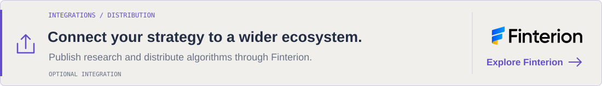](https://finterion.com)

[](https://github.com/Finterion/finterion-investing-algorithm-framework-plugin)


## Development & Contributing

[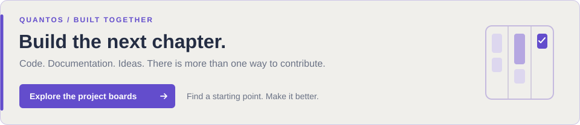](https://github.com/coding-kitties/investing-algorithm-framework/projects)

### What we're working on

Follow the GitHub project boards for tracked work and its latest status.
Open a card for context, then join the discussion before starting a larger change.

**[Planned features](https://github.com/orgs/coding-kitties/projects/3)** · **[Bug tracking](https://github.com/orgs/coding-kitties/projects/5)** · [Source repository](https://github.com/coding-kitties/investing-algorithm-framework)

### Find your way in

| Contribution | Start here |
| --- | --- |
| **Fix a bug** | Check the [Bugs board](https://github.com/orgs/coding-kitties/projects/5), or [report a reproducible issue](https://github.com/coding-kitties/investing-algorithm-framework/issues/new). |
| **Build a feature** | Explore [planned features](https://github.com/orgs/coding-kitties/projects/3) and discuss the approach on the linked issue. |
| **Improve the docs** | Follow the [contributing guide](https://coding-kitties.github.io/investing-algorithm-framework/Contributing%20Guide/contributing) to help with explanations, examples, and tutorials. |
| **Share an idea** | [Open an issue](https://github.com/coding-kitties/investing-algorithm-framework/issues/new) with your use case, or [talk it through on the forum](https://finterion.com/community/forum). |

### From idea to pull request

Fork the repository, agree on the scope in an issue, and make a focused change
with relevant tests and documentation. Link the issue in your pull request and
use the contributing guide for the full setup and review workflow.

Contributions are welcome. Open an issue, choose an existing one, or submit a
pull request against the `dev` branch.

```bash
git clone https://github.com/coding-kitties/investing-algorithm-framework.git
cd investing-algorithm-framework
poetry install
python -m unittest discover -s tests
```

- [Open an issue](https://github.com/coding-kitties/investing-algorithm-framework/issues/new)
- [Contributing guide](https://coding-kitties.github.io/investing-algorithm-framework/Contributing%20Guide/contributing)
- [Architecture references](docs/architecture/README.md)

## Resources

- [Documentation](https://coding-kitties.github.io/investing-algorithm-framework/)
- [Quick start](https://coding-kitties.github.io/investing-algorithm-framework/Getting%20Started/installation)
- [Tutorial notebooks](examples/tutorial/README.md)
- [Strategy showcase](examples/algorithm_examples/strategies_showcase/README.md)
- [Discord](https://discord.gg/dQsRmGZP)
- [Reddit](https://www.reddit.com/r/InvestingBots/)

## Risk Disclaimer

Do not risk money you cannot afford to lose. Backtests and paper trading cannot
guarantee future performance. Validate strategy behavior, execution assumptions,
stored results, and operational safeguards before trading with real funds. The
project and its contributors assume no responsibility for investment results.

## Acknowledgements

Thank you to everyone who has contributed code, documentation, testing, ideas,
and feedback. See [AUTHORS.md](AUTHORS.md) for the contributor list.
